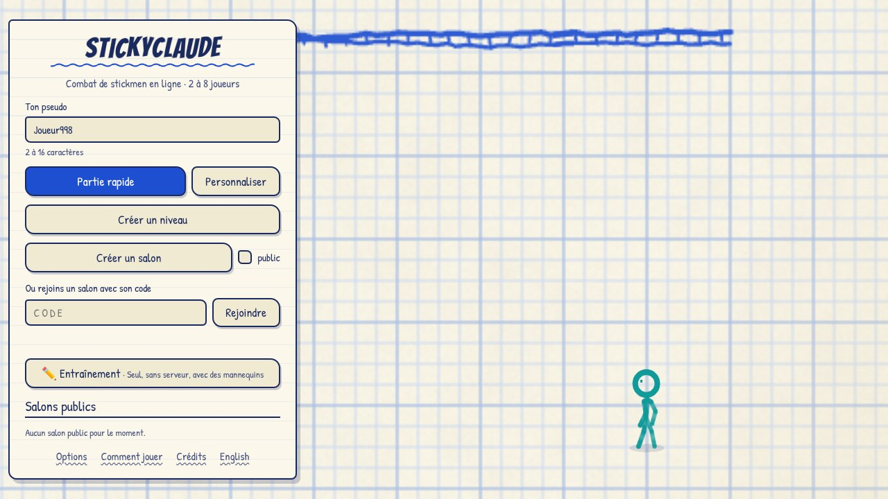
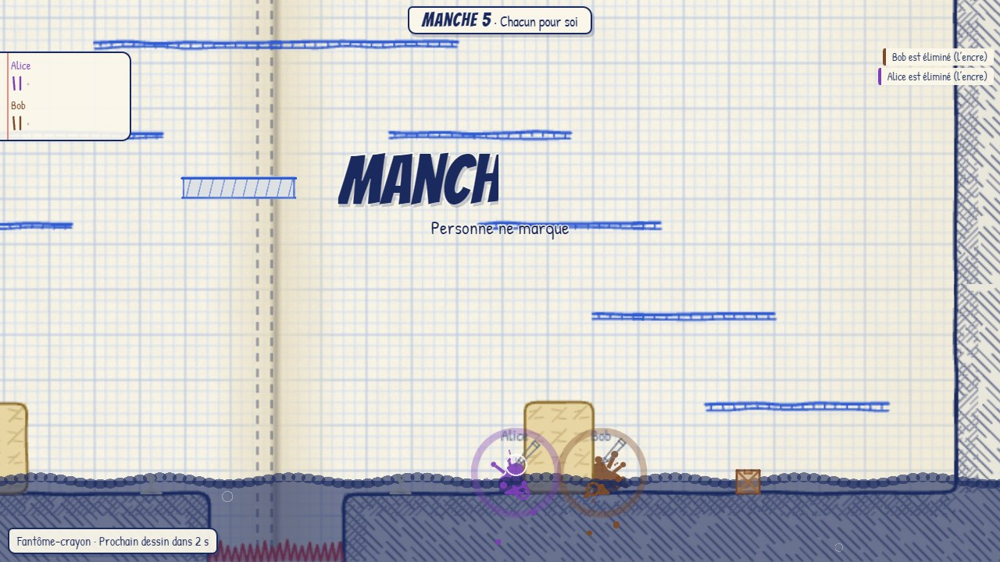
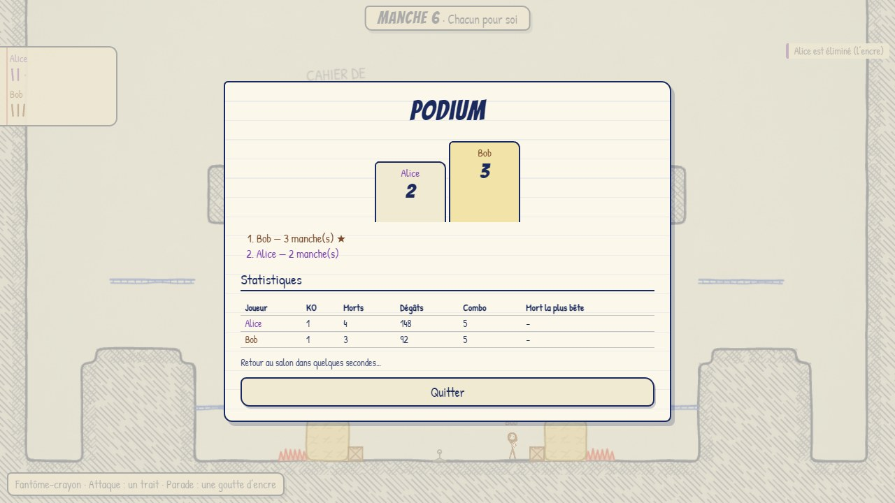
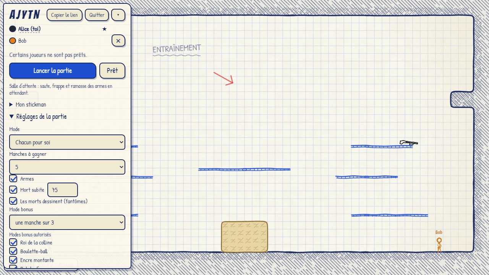
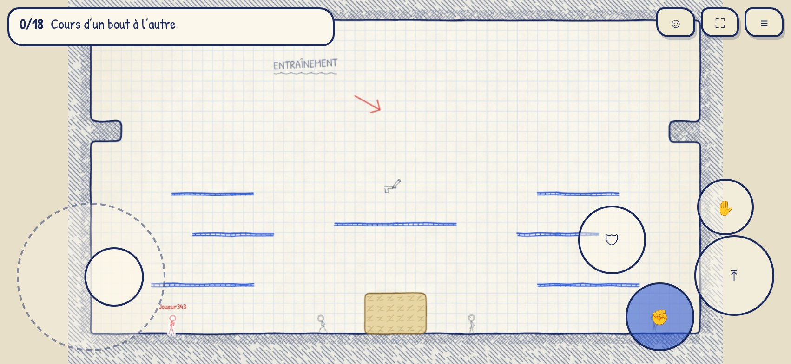

# StickyClaude

Jeu de combat de stickmen en ligne dans le navigateur, de 2 à 8 joueurs, au thème « encre et carnet ». Serveur autoritaire en Node, simulation partagée avec le client (prédiction et réconciliation), rendu PixiJS, interface Preact.



> **État : phase 4 sur 4** (mise en production). Le jeu est complet et habillé : tout est dessiné au stylo sur du papier de cahier (traits qui « bouillonnent », encre qui éclabousse, onomatopées), avec sons et musiques générés par script, une interface française et anglaise, le tactile et la manette, et un entraînement solo contre des mannequins. Il se construit en **une image Docker de 123 Mo** et se déploie sur `https://stickyclaude.sayk.fr` avec la plateforme multi-jeux du VPS : voir [Déploiement](#déploiement) et `docs/DEPLOIEMENT.md`.

|                                           |                                                                         |
| ----------------------------------------- | ----------------------------------------------------------------------- |
|  |                                |
|    |  |

Toutes les captures (`docs/screenshots/`) sont produites par `npm run e2e` ; la planche de référence du style est `19-fiche-de-style.jpg`.

## Démarrage rapide

Prérequis : Node 22 ou plus.

```bash
npm install
npm run dev
```

Ouvre <http://localhost:5173>. Trois façons de jouer :

- **Entraînement** : seul, sans serveur, avec des mannequins et un carnet de 18 objectifs (courir, double saut, saut mural, parade parfaite, armes…).
- **Salons publics** : la liste sous « Créer un salon » permet de rejoindre une partie en un clic (le bouton « Partie rapide » a été retiré de l’accueil).
- **Créer un niveau** (accueil ou salon) : plateformes, fond, pièges, source de la mort subite, apparitions automatiques, essai en entraînement, sauvegarde dans le navigateur ; un niveau proposé au salon entre dans le **vote de la carte** qui précède chaque manche.
- **Créer un salon** : donne un code de 5 caractères (et un lien « Copier le lien ») ; un deuxième onglet le rejoint avec ce code ou ce lien. Dans le salon, on peut déjà sauter, se battre et ramasser des armes (les dégâts n'y comptent pas) ; chacun se déclare « Prêt », l'hôte règle la partie (mode, équipes, tir ami, manches à gagner, arènes, armes, mort subite, modes bonus, fantômes, salon public — **public par défaut**) et la lance.

`npm run dev` lance le serveur (port 3000, avec les outils de développement) et Vite (port 5173, qui relaie `/ws` et `/api`).

**Touches** (modifiables dans Options, par `event.code` : AZERTY et QWERTY partagent les emplacements) : flèches ou WASD/ZQSD pour bouger, **la souris pour viser** (clic gauche : frapper, clic droit : parer ; sans souris, la visée suit la direction tenue), Espace pour sauter (deux fois : double saut, de la même hauteur que le premier saut et non raccourci par un relâchement rapide ; contre un mur : saut mural, qui projette peu pour pouvoir revenir sur la plateforme ; **toucher un mur rend le double saut**), ↓ sur une plateforme fine pour la traverser, **Maj** ou **A** (AZERTY) dash (ruée horizontale de 0,15 s, sans gravité, recharge 0,75 s ; interrompu par un saut, un coup ou un mur ; **sans direction tenue, c'est une esquive sur place**, invulnérable 0,33 s, recharge 1,25 s, sans saut ni coup pendant), **J** frapper (enchaînement de 3 coups qui part au relâchement d'un appui bref ; maintenu : la charge démarre directement, sans coup avant ; ↑ + J : coup vers le haut ; ↓ + J au sol : coup accroupi, plus long, qui projette vers le haut ; ↓ + J en l'air : coup de pied plongeant ; avec une arme : l'utiliser), **E** parer (la parade n'encaisse qu'un coup et étourdit l'attaquant 0,4 s, puis 0,5 s de recharge ; juste après l'appui, la parade parfaite annule le coup), **L** ramasser ou lancer (↓ + L : lâcher) ; manette : LB dash, **1 à 9** emotes, Échap pause, F3 graphe réseau. Éliminé, on devient un fantôme-crayon : J pose un trait, E une goutte d'encre.

**Tactile** : le joystick sert à se déplacer et à viser, l'accroupi est un bouton ; tailles du joystick et des boutons réglables dans Options, tableau des scores masquable (🏆). Des **cœurs** tombent pendant le combat et rendent de la vie (leur nombre suit celui des joueurs).

**Manette** : stick ou croix, A saut, X attaque, B parade, Y ramasser ; la croix et A naviguent dans les menus ; la manette vibre sur les gros coups. **Tactile** : joystick à gauche (déplacement, et la visée suit l'angle du pouce), boutons à droite, emotes, plein écran ; en portrait, un message demande de tourner le téléphone.

**Accessibilité** : mouvement réduit (coupe le tremblement d'écran, le tremblé des traits et l'arrêt sur coup), contraste AA, texte de 90 à 130 %, navigation au clavier et à la manette.

**Tester un mauvais réseau** : ajoute `?lag=150&jitter=30&loss=2` à l'adresse (latence aller-retour 150 ms, gigue ± 30 ms, 2 % de pertes). Plusieurs onglets dans le même salon suffisent pour voir le résultat. Autres paramètres : `?solo=1` (entraînement), `?salon=CODE`, `?auto=1&name=…` (entre directement dans un salon), `?debug=1`.

## Docker

```bash
docker build -f deploy/Dockerfile -t stickyclaude .
docker run --rm --init --read-only --memory 512m --cpus 1 -p 3000:3000 stickyclaude
```

Ouvre <http://localhost:3000> : le jeu, servi par le conteneur (`/healthz` répond `{"ok":true,…}`). C'est exactement l'image de production : utilisateur `node`, système de fichiers en lecture seule, 512 Mo et 1 CPU. Toutes les variables d'environnement sont dans `.env.example` et `docs/DEPLOIEMENT.md`.

## Scripts

| Commande                          | Effet                                                                                                                                                                 |
| --------------------------------- | --------------------------------------------------------------------------------------------------------------------------------------------------------------------- |
| `npm run dev`                     | serveur (3000) + Vite (5173), outils de développement activés ; éditeur d'arènes à `/editor`, planche de référence du style à `/sheet`                                |
| `npm run build`                   | client (`packages/client/dist`, **échoue au-delà de 400 Ko gzip**, hors audio) puis serveur (`packages/server/dist/index.js`)                                         |
| `npm start`                       | lance le serveur construit, qui sert aussi le client                                                                                                                  |
| `npm run check`                   | lint, formatage, types, tests et `audio:check` (à garder vert avant chaque push)                                                                                      |
| `npm test` / `npm run test:watch` | tests Vitest                                                                                                                                                          |
| `node e2e/smoke.mjs --url …`      | test de fumée (CI, contre le conteneur) : 2 clients, une partie, **aucune erreur ni avertissement dans la console** (CSP comprise)                                    |
| `npm run e2e`                     | tests de bout en bout dans Chromium : écrans, entraînement, **partie à 2 onglets**, tactile, connexion perdue ; refait les captures (`-- --sheet` : aussi la planche) |
| `npm run gen-audio`               | régénère les sons et musiques (`packages/client/public/audio`) ; `npm run audio:check` vérifie qu'ils sont à jour                                                     |
| `npm run simulate`                | déterminisme (deux mondes, hash comparé), mouvement seul puis parties enchaînées, et coût d'un pas ; `-- --replay fichier.json`                                       |
| `npm run loadtest`                | faux clients qui se battent contre un serveur construit : `-- --rooms 25 --players 8 --duration 120` ; `-- --no-combat` pour les déplacements seuls                   |
| `node scripts/precompress.mjs`    | précompresse le client construit en brotli et gzip (lancé par `npm run build`)                                                                                        |
| `node scripts/browser-check.mjs`  | N onglets Chromium dans un salon, avec réseau dégradé (`--clients 8 --lag 150 …`)                                                                                     |
| `node scripts/perf-check.mjs`     | FPS et allocations du rendu en émulation mobile : `--cpu 4 --seconds 20 --quality auto` (voir `docs/DECISIONS.md` D56)                                                |

Les scripts Chromium utilisent `CHROME` ou `--chrome` (par défaut, Chrome sous Windows et `/usr/bin/chromium` ailleurs).

## Structure

```
packages/
  shared/   constantes, mouvement, combat, armes, modes, réglages, cosmétiques (fichiers de données uniques), RNG, codecs binaires, schémas zod, arènes JSON
  sim/      simulation pure et déterministe : joueurs, combat, armes, objets, terrain, manches, modes, fantômes, analyse des arènes, relecture
  server/   HTTP + WebSocket, salons, boucle de ticks, entrées, snapshots, compensation de latence, sécurité, métriques
  client/   réseau (prédiction, interpolation), rendu Pixi « encre et carnet » (render/), interface Preact (ui/), état et sources de scène (app/), entrées (input/), audio (audio/), i18n FR/EN (i18n/), éditeur d'arènes et planche de style (dev)
scripts/    simulate, loadtest, browser-check, perf-check, check-bundle, precompress, gen-audio/
e2e/        tests de bout en bout (Playwright) : parcours complet et test de fumée
deploy/     Dockerfile de production, Dockerfile du générateur de charge, blocs pour le hub sayk.fr
docs/       ANALYSE.md, ARCHITECTURE.md, DEPLOIEMENT.md, DIRECTION_ARTISTIQUE.md, ARENES.md, NETCODE.md, DECISIONS.md, CREDITS.md, PROMPTS_SONNET.md, screenshots/
```

`sim` ne dépend que de `shared` : ni E/S, ni DOM, ni horloge système, ni `Math.random` (règles appliquées par ESLint), et aucune allocation dans `step` (mesuré par `npm run simulate`). Il fait deux passes : le mouvement et les actions de chaque joueur (prédits par le client), puis la résolution des coups, des objets et de la partie (serveur seulement). Voir `docs/NETCODE.md`.

Le rendu du client lit une **source de scène** (`app/source.ts`) : le jeu en ligne, l'entraînement solo (la vraie simulation en local) ou l'aperçu de l'accueil. Voir `docs/DIRECTION_ARTISTIQUE.md` et `docs/DECISIONS.md` D48 à D58.

## Outils de développement

- **Éditeur d'arènes** : `npm run dev` puis <http://localhost:5173/editor> (absent de la version construite) : peindre la grille, poser apparitions, objets et zones des modes, tester la vraie simulation dans la page, valider (schéma + accessibilité par simulation) et exporter le JSON. Voir `docs/ARENES.md`.
- **Planche de référence du style** : <http://localhost:5173/sheet> (absente de la version construite) : palette, poses, styles de trait, accessoires, armes, effets et papiers dessinés avec les vrais modules de rendu.
- **Réglage en direct** des 26 constantes de mouvement (`packages/shared/src/movement.ts`) : panneau en bas à droite du build de développement ; les changements sont appliqués à toute la salle.
- **Enregistrement et relecture** : `GET /dev/recording/CODE` (serveur lancé avec `DEV_TOOLS=1`) renvoie les entrées et les opérations du salon ; `?replay=/dev/recording/CODE` les rejoue dans le navigateur, `npm run simulate -- --replay fichier.json` les rejoue en ligne de commande et vérifie le hash.
- **Graphe réseau** (`F3`) : RTT, débit, corrections de prédiction, tampon d'interpolation, avance.

## Mesures

- **Simulation** d'un salon de 8 joueurs en combat (armes, modes, fantômes) : **6 µs par pas** au p50, 15 µs au p99 (budget 150 µs). Débit par client en combat à 8 : **8,7 Ko/s** (budget 20).
- **Charge**, conteneur `--memory 512m --cpus 1` sur le VPS (Xeon 2,3 GHz, 2 vCPU), combat actif : **64 joueurs : 40 % de CPU, boucle p99 8,1 ms, budgets tenus** ; 96 joueurs : 50 %, boucle p99 10,6 ms (limite) ; **200 joueurs (25 salons × 8) : 74 %, boucle p99 16 ms, budgets non tenus** (sur un poste de bureau, les mêmes 200 joueurs tiennent : 48 %, 7,6 ms). Les plafonds de production sont donc de 12 salons et 120 connexions ; détails, protocole et leviers dans `docs/DEPLOIEMENT.md` § 10.
- **Rendu** (`scripts/perf-check.mjs`, Chrome 155, rendu logiciel, téléphone émulé 851 × 393 à DPR 2,75, **CPU ralenti ×4**, entraînement solo, 20 s) : **59,7 FPS en qualité auto** (95ᵉ centile d'image : 16,8 ms ; 4 images sur 1 200 au-delà de 20 ms), 59,9 en haute et en basse ; ≈ 15 Ko alloués par image, 0,7 ramasse-miettes mineur par seconde. Mesure en rendu logiciel : à confirmer sur un vrai téléphone (D56).
- **Bundle** : 325,7 Ko gzip pour un budget de 400 Ko (JS, CSS, polices ; hors audio) ; les 374 Ko de sons sont chargés après le premier écran.

## Déploiement

Le jeu tourne sur `https://stickyclaude.sayk.fr` via la plateforme multi-jeux du VPS (un dépôt = un conteneur = un sous-domaine) :

```bash
games add stickyclaude MiniGamesSayk/StickyClaude stickyclaude.sayk.fr 3000 main   # première fois
games update stickyclaude                                                             # mises à jour
```

Le `.env` à créer, la vérification, la mise à jour, le retour en arrière, les journaux et le dépannage : **`docs/DEPLOIEMENT.md`**. Le serveur de production sert le client précompressé (brotli, gzip) avec une CSP stricte, vérifie l'`Origin`, ne croit `X-Forwarded-For` que de son proxy de confiance, garde `/metrics` en interne, journalise en JSON (pino) et s'arrête proprement sur `SIGTERM` (annonce aux joueurs, délai, fermeture avec le code 1012, reconnexion automatique du client). La CI (GitHub Actions) fait `check`, `build` (budget du bundle), `docker build` (< 150 Mo), lance le conteneur avec ses limites, exécute le test de fumée Playwright et vérifie l'arrêt propre.

## Documentation

- `docs/ANALYSE.md` : analyse fonctionnelle et technique (source de vérité)
- `docs/ARCHITECTURE.md` : organisation du code, du serveur de production, de l'arrêt propre et de la construction
- `docs/DEPLOIEMENT.md` : déploiement pas à pas, variables d'environnement, mesures de charge, dépannage
- `docs/DIRECTION_ARTISTIQUE.md` : palette, traits, polices, animation, éléments à dessiner
- `docs/ARENES.md` : format des arènes, éditeur, comment en ajouter une
- `docs/NETCODE.md` : protocole, formats binaires, délais, compensation de latence, mesures
- `docs/DECISIONS.md` : choix qui précisent ou s'écartent de l'analyse
- `docs/CREDITS.md` : assets et licences
